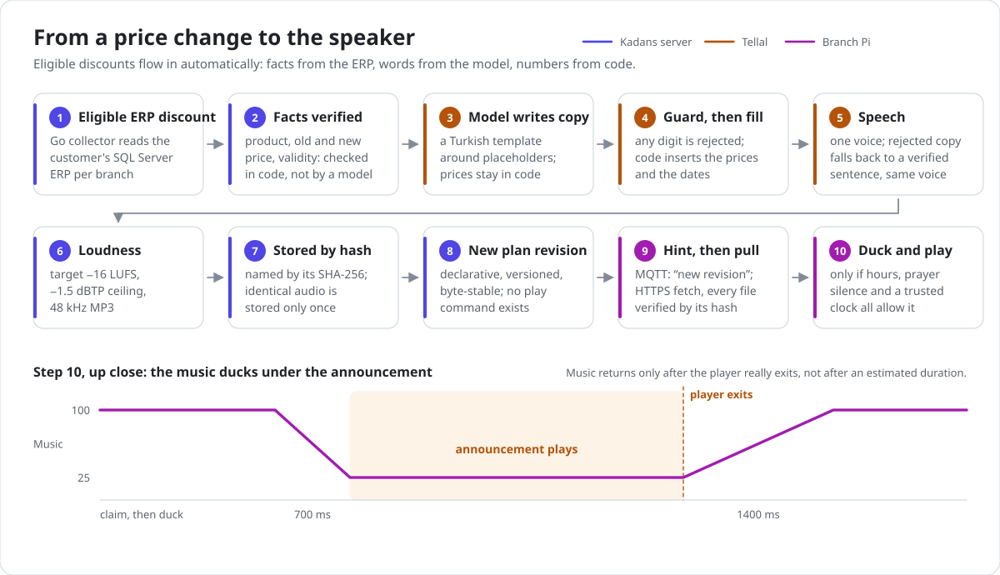
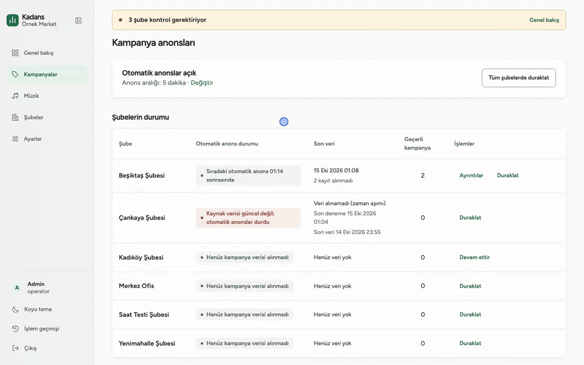
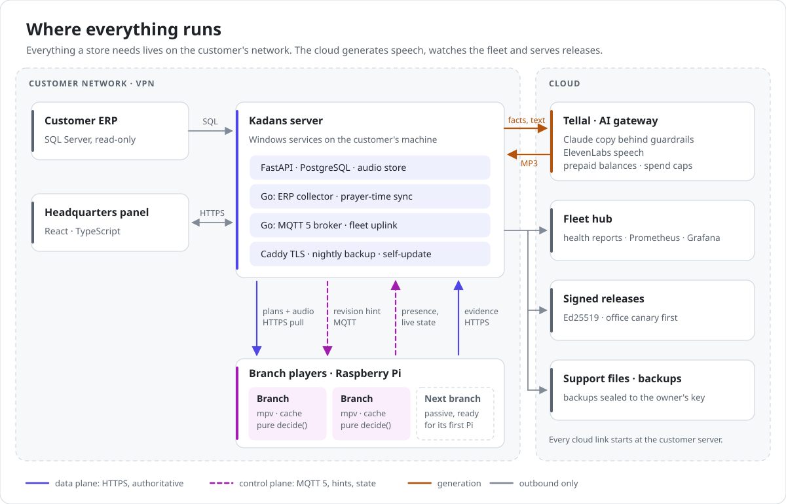

# Kadans

**In-store audio and AI announcements for a regional, multi-city grocery chain with 20+ branches. I designed, built and run it in production, end to end, as the sole engineer.**

When a price drops in the customer's ERP, the store hears a short Turkish announcement over its music. One HQ server on the customer's network manages promotions, music, hours and prayer silence for every branch, and in-store Raspberry Pi players, rolled out in stages, keep playing through network outages. A language model chooses the words; every number comes from code.

<picture>
  <source media="(prefers-color-scheme: dark)" srcset="assets/price-to-speaker-dark.svg">
  
</picture>

*Kadans* is Turkish for cadence; *Tellal* was the Ottoman town crier. The source code is private company property; this repository holds no code, no customer names and no customer data, and all screenshots and audio use test data.

## At a glance

| | |
|---|---|
| **Role** | Sole software engineer: architecture, build, deployment into the customer's systems, releases and operations |
| **Customer** | A regional, multi-city grocery chain with 20+ branches |
| **Runs on** | The customer's Windows server, Raspberry Pi players in the stores, and two cloud services I built: Tellal and a fleet hub |
| **Integrates with** | The customer's SQL Server ERP database, branch network and VPN, and Windows server; Claude (Anthropic) and ElevenLabs |
| **Delivery** | First commit to first customer installation in under three months, then signed, canary-gated releases installed unattended overnight |
| **Stack** | Python, FastAPI, PostgreSQL, Go, MQTT 5, React, TypeScript, Raspberry Pi, Linux, PowerShell, GitHub Actions, Prometheus, Grafana |

*The headquarters panel, shown with test fixtures: an ERP discount with the sentence the store will hear and its audio, then the music library, where every track is loudness-normalized before it reaches a store.*

**Listen:** [MP3](assets/announcement-sample.mp3) · [video with the text](assets/announcement-sample.mp4). A sample in the production voice, generated from test data (8.9 s): *"Ayçiçek yağı 5 litre, 349 lira yerine 299 lira. Bu fırsat 20 Kasım tarihinde sizleri bekliyor."* (Sunflower oil, 5 litres: 299 lira instead of 349 lira. This offer awaits you on 20 November.)

## Architecture

<picture>
  <source media="(prefers-color-scheme: dark)" srcset="assets/architecture-dark.svg">
  
</picture>

- **The server publishes state, never commands.** Each branch gets a versioned plan snapshot, and its Pi decides locally what may play right now, so the store keeps playing correctly through network outages.
- **Two planes.** HTTPS is authoritative for plans, audio and playback evidence. MQTT 5 only announces that a new revision exists; players also poll every 20 seconds, so a missing broker only slows delivery.
- **A store depends only on its own HQ server.** Speech generation, monitoring, support files, backups and updates reach the cloud through outbound connections from that server.

[Full architecture →](docs/architecture.md)

## Key decisions

| Chosen | Why | Rejected |
|---|---|---|
| Declarative, versioned plan snapshots with SHA-256-addressed audio | A lost or repeated message cannot misplay a store | Imperative play commands |
| At-most-once announcements, claimed on disk before the music ducks | A repeated promotion costs more than a missed one | At-least-once playback |
| The model writes words around placeholders; code inserts prices and dates | Removes the failure mode instead of checking for it | Checking numbers after generation |
| One native Windows service on the customer's shared server | Fits the machine the customer already runs | Docker Desktop or WSL on a production server |
| Opaque device credentials, stored only as digests and issued to a chosen branch | Simple rotation and revocation, nothing to forge | JWTs; pairing through an unauthenticated endpoint |
| Outbound-only fleet reporting over MQTT on port 443 | Customer firewalls need nothing new | Inbound access or a remote VPN for operations |

Costs and rejected alternatives: [design decisions →](docs/decisions.md)

## Reliability: how it holds up

| When… | …the system |
|---|---|
| The network or the server is down | keeps playing from the last verified plan; hours and prayer silence still apply offline |
| Power drops mid-announcement or mid-write | drops that announcement instead of replaying it; device state is written atomically and heals itself |
| A branch stops announcing | shows it in the panel with the device's reason, derived from missing playback reports |
| A branch network has no internet time | takes a trusted clock from its own server over verified TLS |
| One credential is used by two devices | flags a duplicate device in the panel and the fleet report |
| A release is bad | stops at the office canary by default; a failed server upgrade rolls back, and a Pi whose new player is not healthy within 90 seconds switches back |
| The model writes a number | rejects the copy and asks for up to two rewrites; if none passes, the store hears the verified standard sentence in the same voice |
| The customer's disk is lost | restores from a nightly off-site backup sealed to the owner's key, and every device keeps trusting the restored server |

[Engineering notes →](docs/engineering-notes.md)

## Built on Tellal

Copy and speech come from [Tellal](https://github.com/berkaybakac/tellal-case-study), the AI announcement platform I designed and built alongside Kadans: Claude (Anthropic) writes words around placeholders so the model never states a price, ElevenLabs speaks them, and prepaid balances, scoped keys and spending caps guard every paid call. Kadans sends only verified facts and keeps a deterministic standard sentence for when no copy can be had. Tellal also hosts the fleet hub, the signed release catalog and the sealed backup relay Kadans uses.

## How I work

I own the architecture, every decision and every release. I write each decision down with its trade-off, and each guarantee has a test that fails when the guarantee is removed. I use Claude Code and Codex daily as coding agents under a repository contract and per-step approval; I verify every change and every review finding against the code myself, and the repository's rules are enforced by tests.

## Read more

- [Architecture](docs/architecture.md): components, the two planes, trust boundaries and integration with the customer's systems.
- [Design decisions](docs/decisions.md): what was chosen, why, what it costs, and what was rejected.
- [Engineering notes](docs/engineering-notes.md): how the system stays correct on store power, store networks and unattended servers.
- [Tellal case study](https://github.com/berkaybakac/tellal-case-study): the AI announcement platform.
- [Milestones](docs/milestones.md): how it reached its first customer.

[AnnounceFlow](https://github.com/berkaybakac/announceflow) was the per-store predecessor: one installation per store, in use at four locations. Kadans moves control to headquarters: the server describes the state each store should be in, and each store works out on its own what to play.
