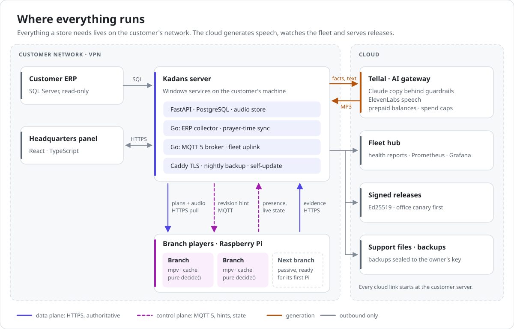

# Architecture

<picture>
  <source media="(prefers-color-scheme: dark)" srcset="../assets/architecture-dark.svg">
  
</picture>

## Components

| Component | Where it runs | Responsibility |
|---|---|---|
| **Kadans server** (Python, FastAPI, PostgreSQL) | The customer's Windows server, as one supervised Windows service | Owns schema, policy and credentials. Turns ERP discounts into campaigns, decides when announcements may play, and publishes one versioned plan per branch. |
| **ERP collector** (Go) | Same service | Reads the customer's SQL Server ERP read-only, per branch, on staggered, bounded schedules with parameterized queries. |
| **MQTT 5 broker** (Go, embedded) | Same service, behind Caddy over TLS WebSocket | Carries revision hints, device presence and live sound state, with per-device topic ACLs. It has no database access. |
| **Panel** (React, TypeScript) | The operator's browser | Branches as a region tree, music, opening hours, prayer silence, campaigns, users and audit history, in plain Turkish. |
| **Branch player** (Python) | A headless Raspberry Pi in each store | Caches the plan and its audio, decides locally what may play now, ducks the music, and reports what really happened. |
| **Tellal** | Cloud | The AI announcement platform: copy, speech, prepaid balances, the release catalog, the fleet view and sealed relays. See [Tellal](tellal.md). |
| **Fleet hub** (Go) | Cloud | Receives each customer server's fleet report and exposes Prometheus metrics for dashboards and Grafana alerting. |

## Two planes

- **Data plane: HTTPS, authoritative.** Players pull plans and audio, verify every file by its SHA-256 hash, and upload evidence of what they played. Uploads are retry-safe and deduplicated, so an outage only delays them.
- **Control plane: MQTT 5, hints only.** When a branch's plan changes, the broker publishes the new revision and the player fetches it over HTTPS at once. Players also poll every 20 seconds, so a missing broker only slows delivery. Acknowledgements and live state appear in the panel as status, never as proof of playback.

The server never sends a play command. It publishes the state each branch should be in, and the player reconciles toward it. Network faults change how quickly a store receives its plan, never what the store does once it has it.

## Integration with the customer's systems

- **ERP database.** The collector is the only process that opens a connection to the ERP. A connection change made in the panel waits as a candidate with its password sealed (AES-GCM) and replaces the working connection only after the collector's test passes. New warehouses become branches by themselves and stay passive, announcing nothing, before their first Pi connects.
- **Network and VPN.** Branches reach headquarters only over the customer's VPN. Players take their plans, audio, clock and updates from their own HQ server over verified TLS, so branch networks need no internet access for playback.
- **Windows server.** A Go supervisor runs the API, reverse proxy, broker and ERP workers as one Windows service beside native PostgreSQL bound to loopback, with checksum-pinned dependencies and its own virtual account.
- **Branch rollout.** Each night the server seals a device bundle for every branch still waiting for its Pi. One command prepares a Raspberry Pi from it and proves that the Pi reaches its server.

## Trust boundaries

- **Application traffic stays on the customer's network and VPN.** The stack is never exposed to the public internet.
- **Device identity comes only from the credential.** The server derives tenant, branch and device from it; request parameters never decide scope.
- **Cloud links are outbound.** The customer server publishes to the fleet hub and pulls signed releases from the catalog, so monitoring and updates need no inbound connection.
- **What leaves the customer's network** is limited to:
  - verified campaign facts sent to Tellal, which returns audio;
  - branch and device health in the fleet report;
  - a nightly support file with logs and reports, never settings, credentials or keys;
  - a nightly backup and new-branch device bundles, both sealed to a key that only the owner holds.

## Players in detail

- **One pure decision function**, `decide(plan, now, recent_history)`, chooses what may play. It does no I/O, so every combination of hours, prayer silence and clock trust is tested as a table of cases. A test keeps decision code free of I/O imports.
- **One sound policy, two copies.** Device and server hold byte-identical copies of the sound policy, enforced by a test, and both run one shared file of boundary cases.
- **Music and announcements play in separate mpv processes.** Music ramps from 100 to 25 in 700 ms, and back over 1400 ms only after the announcement player has actually exited, not after an estimated duration.
- **Storage stays bounded.** A plan activates only after every file verifies, and the player keeps only the files that its current or previous plan uses.
