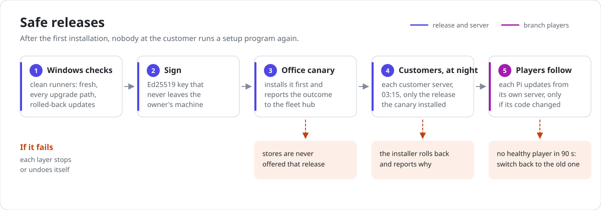

# Design decisions

Each entry gives the choice, why, and what was rejected; costs where they matter, and a revisit condition where one was recorded.

## Declarative desired state, not commands

- **Choice.** The server publishes one versioned, byte-stable plan snapshot per branch, with every audio file named by the SHA-256 of its final bytes. Players reconcile toward it.
- **Why.** A store that misses a message is correct after its next fetch, and an offline store keeps following its last plan. Downloads verify themselves, and identical audio for many branches is stored once.
- **Cost.** Every behaviour has to be expressible as data. Players ignore unknown fields and reject unsupported schema versions without dropping their last-known-good plan; schemas 2 and 3 added offline hours, prayer silence and playlists while schema 1 stays supported.
- **Rejected.** Play commands, which get lost or replayed.

## Hints over MQTT, truth over HTTPS

- **Choice.** An embedded Go MQTT 5 broker carries only revision hints, presence and live state. Plans, audio and evidence travel over HTTPS. The broker mirrors plan heads by polling them, so it needs no database access.
- **Why.** Losing the broker costs speed, never correctness: players fall back to polling. The network-facing process can never become a second source of truth.
- **Cost.** Two protocols to operate.
- **Rejected.** Plans delivered over MQTT; a transactional publication outbox, which would have given the broker database access.

## At-most-once announcements

- **Choice.** A player claims each announcement on disk (fsync and atomic rename) before it ducks the music. After a crash, an unfinished claim is dropped and reported, never replayed.
- **Why.** A promotion repeated after a power cut costs trust; a missed one costs nothing and appears in the panel with its reason.
- **Cost.** A power cut can cost one announcement; the rotation offers the campaign again later.
- **Rejected.** At-least-once playback.

## A functional core on the device

- **Choice.** `decide(plan, now, recent_history) -> Action` is pure. Playback, files and network sit around it. One sound policy decides music and announcement permission with every blocking reason, combined as a union rather than a precedence list.
- **Why.** Hours, prayer silence, clock trust and announcement spacing are tested as plain cases, without hardware. Device and server answer the same question the same way.
- **Cost.** State has to be passed in explicitly. The policy exists in two deployables, so a test keeps both copies byte-identical.
- **Rejected.** A shared runtime between device and server, more expensive than one duplicated module proven identical by a test.

## Missing data degrades gracefully

- **Choice.** Past a prayer calendar's end, the server fills days from last year's same-day times; an untrusted clock holds only announcements while music follows hours. The panel warns 30 days before a calendar ends.
- **Why.** A configured store going silent because of missing data is worse than playing with a warning.
- **Rejected.** "Uncertainty means silence", the stricter rule this replaced.

## Language model behind guardrails

- **Choice.** The model writes only the words around four placeholders; code inserts product, prices and dates as spoken Turkish. Today-only, last-day and branch-exclusive openings are computed from ERP facts, and an advertising-law content policy filters restricted products before any model call.
- **Why.** Natural copy without trusting the model with facts.
- **Cost.** Copy is less free-form, and each new wording is a new versioned profile, tried on sample campaigns before it goes live.
- **Rejected.** Checking numbers after generation. Details in [Tellal](tellal.md).

## Native Windows installation

- **Choice.** One Windows service: a Go supervisor runs the API, Caddy, the MQTT broker and the ERP workers beside native PostgreSQL. Docker Compose stays for development and Linux.
- **Why.** The customer's HQ server is a shared Windows production machine; a native service fits it and needs no extra platform.
- **Cost.** Two deployment shapes.
- **Rejected.** Docker Desktop or WSL on a production server.
- **Revisit** if a customer provides a Linux host.

## Signed, canary-gated updates

<picture>
  <source media="(prefers-color-scheme: dark)" srcset="../assets/releases-dark.svg">
  
</picture>

- **Choice.** Releases are signed offline with Ed25519 over a domain-separated message. Each night the customer server's Go self-update checks for the release it is offered; when there is a new one, it verifies host, signature, size and SHA-256, installs silently, and restores the previous release if the service changeover fails. By default a customer is offered only the release the office canary reported installing successfully. Pis pull the player of their own server's release.
- **Why.** Nobody at the customer has to run a setup program; TLS proves who you talk to, the signature proves what you install, and the canary proves that it works.
- **Cost.** A fix reaches customers a night after the canary takes it.
- **Rejected.** Pis updating from a cloud service, which would need per-device work and data leaving the customer's network.

## Credentials a stolen database cannot use

- **Choice.** Device credentials are 256 random bits; the server stores only their SHA-256 digest, compares in constant time and derives scope from the credential. Rotation overlaps old and new credentials. Credentials are issued to a chosen branch by an operator, or sealed to the owner's key by the customer's own server for a branch still waiting for its Pi.
- **Why.** A stolen database holds no usable credential, a credential rotates without taking a store offline, and a poll costs no database write.
- **Cost.** Lost credentials can only be reissued.
- **Rejected.** JWTs, per-poll database writes, and pairing unassigned devices, which would need an unauthenticated endpoint.

## Outbound-only operations

- **Choice.** Each customer server publishes a versioned fleet report over MQTT 5 on WebSocket and TLS, port 443, with Last Will presence, to a central Go hub that allows each customer to publish only under its own prefix. Support files and sealed backups are also pushed out.
- **Why.** Customer firewalls need nothing new, and monitoring needs no inbound connection.
- **Rejected.** A remote-access VPN as part of normal operation.

## Python for the product, Go for long-running workers

- **Choice.** Python, FastAPI and PostgreSQL for the product; Go for the long-running workers: ERP collector, MQTT broker, prayer-time sync, Windows supervisor, fleet uplink and hub, and self-update. The rule: keep the existing stack, and prefer Go or MQTT where they fit equally well on function, reliability, maintenance and operating cost.
- **Why.** One engineer operates everything, so every component has to earn its place.

## Weekly rules evaluated directly

- **Choice.** Recurring weekly permissions, such as opening hours, are declarative rules evaluated directly.
- **Rejected.** A rolling schedule horizon that would need expanding and keeping in sync.
